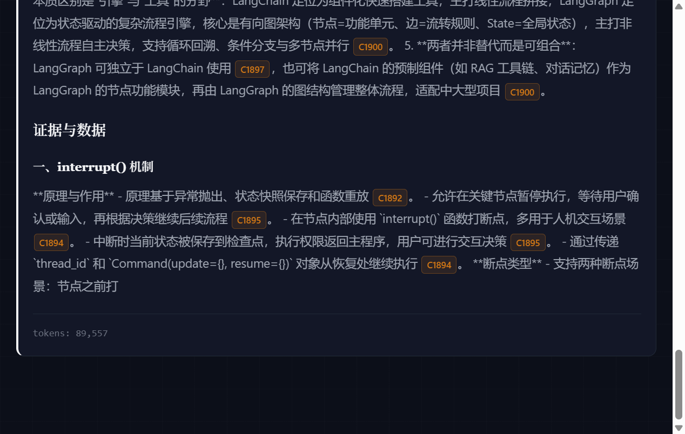
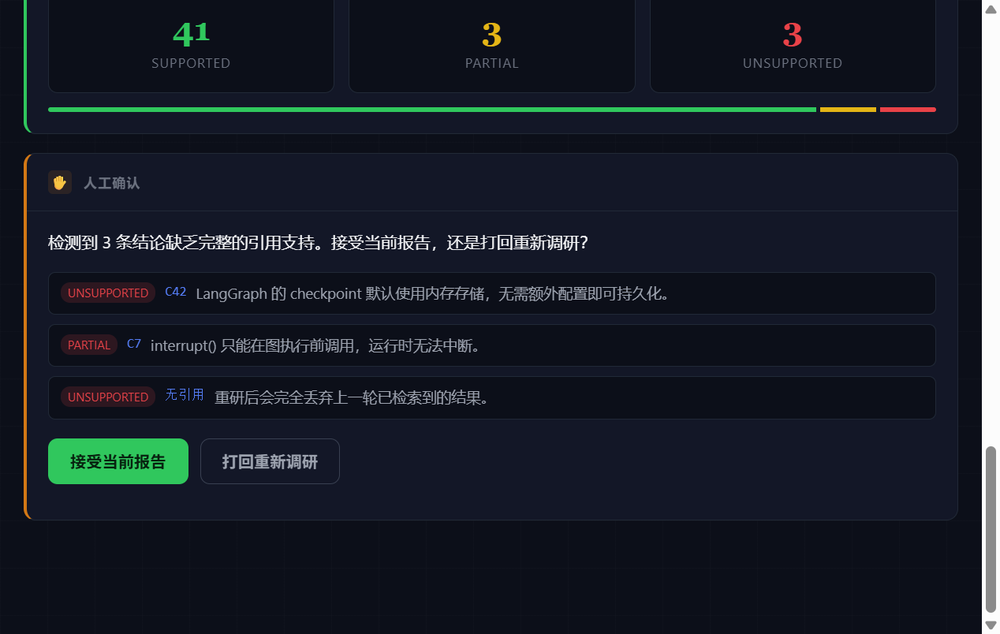

# Deep Research Agent

[](https://github.com/3575873939/deep-research-agent/actions/workflows/ci.yml)

[](LICENSE)
[](https://github.com/3575873939/deep-research-agent/actions/workflows/ci.yml)

给定问题 → 自主调研 → 产出**带引用可验证**研究报告的通用研究型 Agent。

**别人交 demo，你交 demo + 评估报告**——每个模块都留量化数据。



---

## 一句话面试叙事

我做了一个端到端的研究型 Agent：LangGraph 状态机编排、混合检索 RAG、MCP 工具层、可中断的人工确认、SSE 流式输出、token 预算熔断，并且有一套**引用可验证率**评估体系——每个事实性结论都能回溯到入库的网页原文快照。

---

## 架构图

```
┌──────────────────────────────────────────────────────────────┐
│  LangGraph 状态机                                              │
│                                                                │
│  planner ──► researcher ──► synthesizer ──► verifier           │
│                 ▲                             │                │
│                 │                    ┌────────┴────────┐       │
│                 ├──── redo ◄─────────│ 质量不达标？     │       │
│                 │                    └─────────────────┘       │
│                 │                             ▼                │
│                 │                   human_review（可选）        │
│                 └──── redo ◄────────┤ interrupt() 暂停        │
│                                     └ 等人确认 accept / redo    │
└──────────┬──────────────┬───────────────┬────────────────────┘
           ▼              ▼               ▼
       工具层        混合检索 RAG      预算/守卫层
   search(内置 或    切分 → BM25+向量   token 计量
   MCP server)      双路召回 → RRF     预算预检（调用前）
   fetch(网页抓取)   → 选块进 context  429 退避 + 熔断
           │              │               │
           ▼              ▼               ▼
    引用库(SQLite 原文快照 + sha256)   trace(JSONL)
```

---

## 快速开始

```bash
# 1. 安装
cd deep-research-agent
pip install -e ".[eval]"

# 2. 复制环境变量
cp .env.example .env
# 编辑 .env：填入 DRA_API_KEY，以及 SERPAPI_KEY 或 TAVILY_API_KEY（至少一个）

# 3. CLI 跑一条问题
python -m dra.cli "LangGraph 的 checkpoint 机制是如何工作的？" --show-citations

# 4. 启动服务
uvicorn dra.server.app:app --reload
# 访问 POST /research 或 POST /research/stream (SSE)，浏览器打开 http://127.0.0.1:8000

# 5. 批量评测（断点续跑）
python evals/run_eval.py --limit 5
```

可选增强（缺失均自动降级，不影响主链路）：

```bash
pip install -e ".[vec]"    # 向量召回（缺失 → BM25-only）
pip install -e ".[mcp]"    # MCP 工具层（缺失 → 仅用内置 search/fetch）
```

---

## 实测指标

数据集 30 题（技术原理 / 产品对比 / 时效性 各 10 题），全量跑通于 `evals/results.jsonl`。

| 指标 | 定义 | 目标 | 实测 |
| --- | --- | --- | --- |
| 引用可验证率 | (supported + partial) / 验证总数 | ≥ 85% | **87.8%** |
| 幻觉结论率 | unsupported / 验证总数 | ≤ 10% | **0%** |
| 检索命中率 | 金标准来源出现在引用中的比例 | ≥ 70% | 56.7%（未达标，见下） |
| 工具成功率 | 工具调用成功数 / 总数 | — | 83.2% |
| 单题成本 | token / 题 | — | 91K |
| 平均耗时 | 秒 / 题 | — | 218s |

**口径说明**：上表为 **RAG 接入前**的全量基线（30 题）。RAG 接入后做过同模型 A/B，调研节点 token −42%，但尚未重跑全量 30 题，因此上表未更新。

**检索命中率 56.7% 是已知限制**，非实现缺陷：中文 query 检索英文官方文档存在索引覆盖错配。已实测 Tavily → SerpAPI/Google → `site:` 限定三条路径均无法突破，属结构性上限。

---

## 关键设计决策

1. **verifier 是独立节点而非 prompt 里一句"请核实"**——评估与生成分离，可独立测试，不通过可打回重研。
2. **引用格式强制结构化**：每个结论必须挂 `[cite:N]`，N 对应 SQLite 里的原文快照 + sha256 哈希，机器可查、可溯源。
3. **预算熔断前置**：不是事后统计，而是每次 LLM 调用前检查预算余量，不足直接降级/终止。
4. **节点级模型路由**：planner / researcher / synthesizer / verifier 各自可配模型——默认 verifier 与生成侧异模，避免"自我认可"偏差。
5. **429 退避 + 熔断**：先按 `Retry-After` / 指数退避重试，重试耗尽才熔断冷却，避免把偶发限流升级成长时间停摆。
6. **工具层错误归一化**：所有工具返回 `ToolResult(ok, error_type, latency, raw_len)`，eval 可单独统计工具成功率。
7. **可选依赖一律可降级**：向量索引、reranker、MCP、分析器缺失时自动退化，保证 CI / 无 GPU / 断网环境全链路可跑。

---

## 混合检索 RAG

抓回的网页大半与子问题无关，整页灌入既烧 token 又稀释注意力。改造后的链路：

```
抓取页面 → 滑窗切分(500 token/50 overlap, 句边界对齐)
        → BM25Plus + 向量 双路召回
        → RRF 融合(k=60)
        → [可选] bge-reranker 精排
        → 按来源聚合 → 证据块进 context
```

关键设计：**引用粒度不变**——chunk 只携带来源下标，引用仍是「一来源一条、快照为整页原文」，因此 verifier 与 eval 的语义完全不受影响。

同模型 A/B 实测（t01，ModelScope `DeepSeek-V4.1-Flash`）：

| 节点 | RAG-OFF | RAG-ON | 变化 |
| --- | --- | --- | --- |
| researcher | 44,553 | 25,840 | **−42%** |
| 合计 | 156,983 | 89,557 | −43% |

引用可验证率与幻觉率两臂一致，未退化。另有零 LLM 成本的确定性复现（`evals/rag_ab_replay_all.py`）对 47 次运行测得 context 体积中位压缩 52.8%。

完整方案见 [`docs/RAG接入技术方案.md`](docs/RAG接入技术方案.md)。

---

## 人工介入（human-in-the-loop）

当 verifier 检出「缺乏引用支持」的结论时，流程可在报告定稿前**暂停等人确认**——接受当前报告，或打回重新调研。



实现要点：

- 用 LangGraph 原生 `interrupt()`，**不自造轮子**；状态由 `AsyncSqliteSaver` 持久化，进程重启后仍可从断点恢复（`Command(resume=...)`）
- 人工确认是**例外路径而非常规流程**：只在存在风险结论时才触发，质量达标的运行完全不受打扰
- **默认关闭**（`DRA_HUMAN_REVIEW=false`）：评测与批量跑必须全自动，人为确认会破坏可复现性
- 打回受轮次上限约束，避免"人一直选 redo → 死循环"

```bash
# 开启后 CLI 会在断点处交互询问
DRA_HUMAN_REVIEW=true python -m dra.cli "你的问题"

# 或单次开启
python -m dra.cli "你的问题" --human-review
```

服务端：触发时 SSE 会发 `interrupt` 事件（含待确认结论列表），前端渲染确认卡片；
调用 `POST /research/resume`（`{"run_id": "...", "action": "accept|redo"}`）继续。

---

## MCP 工具层

支持通过 **MCP（Model Context Protocol）** 接入外部工具，传输走 stdio（server 作为子进程）。

- 适配后与内置工具**同构**：同一个 `Tool` 协议 + `ToolResult` 错误归一化，调用方无需区分工具来源
- **重试纪律沿用 MCP 自身语义**：只有标注 `readOnlyHint=true` 的工具才允许重试，写操作一律不重试
- 配置了 `DRA_MCP_SEARCH_TOOL` 后，该 MCP 工具会**替代内置检索源**进入 researcher 主链路；否则默认使用内置 SerpAPI/Tavily/DuckDuckGo
- 默认不配置 → 不启动任何子进程、零额外开销；server 连不上或包缺失自动降级

```bash
# 配置（.env）
DRA_MCP_SERVERS=[{"name":"fs","command":"npx","args":["-y","@modelcontextprotocol/server-filesystem","/tmp"]}]
DRA_MCP_SEARCH_TOOL=myserver.web_search

# 查看已连接的 server 暴露了哪些工具
python -m dra.cli --list-mcp-tools
```

---

## 目录结构

```
deep-research-agent/
├── pyproject.toml
├── .env.example
├── README.md
├── LICENSE
├── docs/                  # 设计与方案文档
├── .github/workflows/     # CI（跑全量测试，刻意不装 sentence-transformers 以覆盖降级路径）
├── src/dra/
│   ├── config.py          # 节点级模型路由 + RAG/MCP/人工介入开关
│   ├── cli.py             # CLI 入口
│   ├── graph/             # LangGraph 编排（planner/researcher/synthesizer/verifier/human_review）
│   ├── rag/               # 混合检索：切分 / BM25 / 向量 / RRF / rerank
│   ├── tools/             # 工具协议 + 搜索 + 网页抓取 + 引用库 + MCP client
│   ├── provider/          # LLM 通道抽象（OpenAI 兼容 + Anthropic）+ 预算/熔断
│   ├── guard/             # 预算守卫 + prompt injection 防护
│   ├── server/            # FastAPI + SSE + 前端页面
│   └── trace/             # JSONL trace
├── evals/                 # 评估数据集 + 批量跑 + 指标 + 报告
└── tests/                 # pytest（43 个用例）
```

---

## 评测数据说明

`evals/` 下保留的实验记录：

| 文件 | 内容 |
| --- | --- |
| `dataset.jsonl` | 30 题评测集（含金标准来源） |
| `results.jsonl` | 全量 30 题基线结果 |
| `results_ms_rag_on.jsonl` / `results_ms_rag_off.jsonl` | RAG A/B 对照 |
| `results_aihubmix.jsonl` | 跨模型对照尝试 |
| `reports/*.md` | 每题生成的报告原文 |

`rag_ab_replay.py` / `rag_ab_replay_all.py` 为确定性复现脚本（零 LLM 成本）。

---

## Roadmap / 未实现

以下能力**当前代码尚未实现**，在此明确声明以免误解：

| 项 | 状态 |
| --- | --- |
| 代码沙箱工具 | 未实现 |
| 向量数据库 | 未实现。向量检索为进程内暴力余弦，未引入向量库；每 run 语料仅几十页，引入只增复杂度 |
| 任务成功率人工判定 | 未完成。数据集已跑通，但人工判定标注未做 |
| 多轮对话式追问 | 未实现。当前每次调研独立，无跨轮语境 |

---

## License

MIT，见 [LICENSE](LICENSE)。
